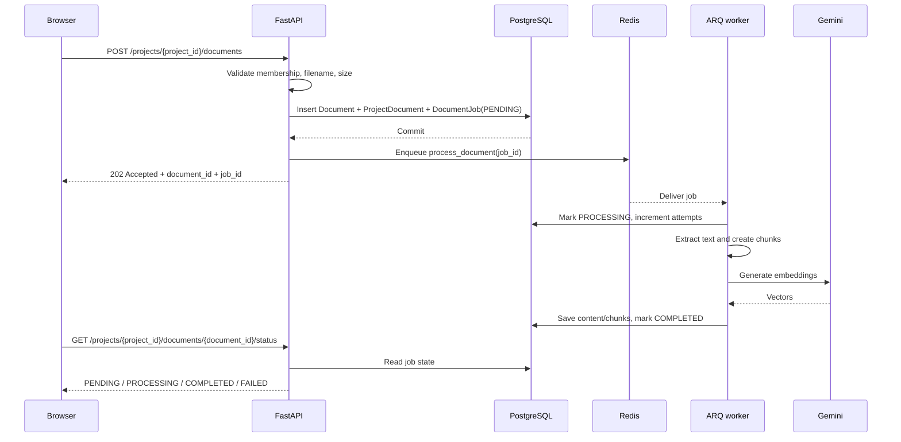

# Asynchronous Document Ingestion

## Why this is a background job

PDF extraction, text chunking, and embedding generation can take seconds or minutes. Doing all of that inside an HTTP request keeps an API worker occupied and makes client timeouts more likely.

The project upload endpoint therefore accepts the file, persists a job, and returns `202 Accepted`. The ARQ worker performs the expensive work separately.

## Request and worker flow

## Persistence model

- `documents`: document identity and extracted text.
- `project_documents`: association between a document and a project.
- `document_jobs`: durable processing state, original upload bytes, retry count, safe error, and timestamps.

The upload and job rows are committed before Redis enqueue is attempted. This means a Redis outage does not lose the upload: the job remains `PENDING` and can be queued again through the retry endpoint.

## Job states

| State | Meaning |
|---|---|
| `PENDING` | Upload is persisted and waiting for a worker |
| `PROCESSING` | A worker is extracting, chunking, or embedding |
| `COMPLETED` | Extracted text and all chunk embeddings are committed |
| `FAILED` | Processing failed; a safe error is available and the job can be retried |

A retry is accepted for failed/pending jobs. A job left in `PROCESSING` for more than 15 minutes can also be retried after a worker interruption.

## API

### Upload

`POST /api/v1/projects/{project_id}/documents`

Multipart field: `file`

Successful response: HTTP 202 with document ID, job ID, initial status, and whether Redis accepted the enqueue.

The current upload limit is 10 MB.

### Check status

`GET /api/v1/projects/{project_id}/documents/{document_id}/status`

The project membership check is performed before returning job details.

### Retry

`POST /api/v1/projects/{project_id}/documents/{document_id}/retry`

Only project writers can retry. The endpoint reuses the persisted upload; the user does not need to upload the file again.

## Operational considerations and current limitations

- Start the worker with `arq app.workers.worker.WorkerSettings` from the backend directory.
- The API and worker must use the same PostgreSQL and Redis configuration.
- Upload bytes are stored in PostgreSQL for this initial implementation. This keeps the first version durable and simple, but is not ideal for large files or high upload volume. A production deployment should store originals in a private object-storage bucket and persist only the object key in `document_jobs`.
- Redis enqueue is performed after the database commit. A failed enqueue leaves a durable pending row, but automated outbox polling/reconciliation is still future work.
- A worker killed abruptly may leave a job in `PROCESSING`; the retry endpoint permits recovery after 15 minutes.
- The legacy personal-document upload endpoint remains synchronous for backward compatibility. Project uploads use the ARQ flow.
- End-to-end tests with live Redis and Gemini credentials are still required; automated tests mock the embedding provider.

## Interview discussion

**Why return 202 instead of 200?** The API has accepted and persisted the work, but the document is not ready yet. The client checks the status resource.

**Why store a job row in PostgreSQL if ARQ already stores jobs in Redis?** PostgreSQL is the durable source of truth for user-visible status and recovery. Redis is the delivery mechanism. If Redis is unavailable, the pending job record still exists.

**Why not call Gemini from the request handler?** Embedding calls are network-bound and may be slow. Moving them to a worker keeps API latency predictable and lets worker concurrency be controlled independently.

**What is still needed for production?** An object-storage upload flow, transactional outbox or pending-job reconciler, idempotent worker locking/leases, live integration tests, and metrics for queue age, processing duration, retries, and failure rate.
